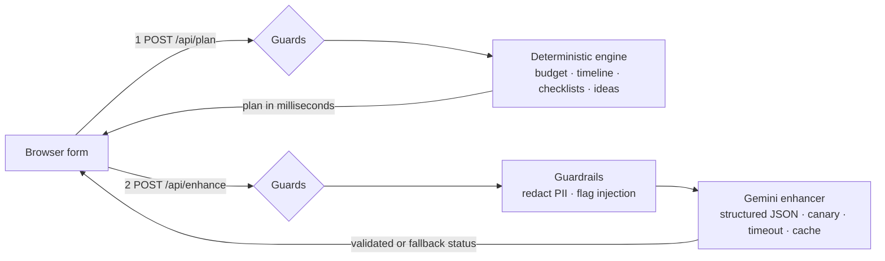

# Jubilee: a GenAI celebration planner

> **Challenge 5 · Celebration & Event Planner.** A planning assistant that helps people organise weddings, birthdays and
> community events with budgets, timelines, vendor checklists and personalised ideas.

**Live demo:** _add your Vercel URL here after deploying_ · **Branch:** single (`main`) · **Runtime dependencies:** 4
(`next`, `react`, `react-dom`, `@google/genai`) · **Tests:** 169, no network required

**Stack:** Next.js 16 (App Router) · React 19 · strict TypeScript · Gemini (`gemini-3.8-flash`) through the Interactions API ·
Vitest · Vercel.

## 1. Chosen vertical and persona

**Vertical:** Celebration & Event Planner, covering all three named event types (wedding, birthday, community event).

**Persona:** a *first-time organiser*: a parent, sibling or neighbourhood volunteer with a fixed budget and little time.
*Cognitive load:* they are juggling work and family, and do not know what vendors will ask. *Mental model:* many expect either
a search engine ("tell me the price") or a human planner ("handle it"). Jubilee is neither, so it says up front what it does
and does not do (see "What Jubilee does, and what it doesn't" on the page).

**Root challenge:** a generic chatbot answers "plan my wedding" with a wall of text, wrong arithmetic and no dates. The
organiser needs numbers that add up, deadlines they can act on today, and honest warnings when the plan does not fit reality.

## 2. User stories (the challenge, restated)

- *As an organiser with a fixed budget,* I want a split that adds up exactly and tells me why each line is that size, so I can trust and adjust it.
- *As someone with limited time,* I want a dated timeline that compresses when the event is soon and tells me what to book first.
- *As someone who has never hired a caterer,* I want vendor checklists with the questions to ask and what to put in the contract.
- *As someone with a specific vision,* I want ideas that reflect my notes, city, setting and priorities, not a template.
- *As a careful user,* I want the plan even if the AI is slow or down, and I want my notes kept private.

## 3. Approach and logic

The central design decision: **code owns the numbers, the model owns the words.**

| Concern | Handled by | Why |
|---|---|---|
| Budget split, per-guest maths, feasibility, "why this amount" | Deterministic engine (`src/domain/budget.ts`) | LLMs are unreliable at arithmetic. The split always sums to the exact total (largest-remainder apportionment). |
| Dated timeline, compression when time is short | Deterministic engine (`src/domain/timeline.ts`) | Dates must be right and reproducible. |
| Vendor checklists and contract checks | Declarative catalog + rules (`catalog.ts`, `checklist.ts`) | Questions are tailored by event type, setting and crowd size. |
| Themes, personal touches, risks, vendor tips | Gemini, constrained to a JSON schema | Language and creativity adapt to the user's notes. |

The assistant makes **logical decisions from context**:

| Context the user gives | What the planner does |
|---|---|
| Event type | Different spend profile, milestone set and vendor list (no attire line for a birthday). |
| Guest count | Shifts weight toward catering and logistics for large crowds, toward décor and entertainment for intimate ones. |
| Venue free or owned | Cuts venue spend to a small allowance and redistributes the saving. |
| Outdoor setting | Raises the contingency reserve, adds tents/power/weather budget, a weather-backup milestone and vendor question. |
| Priorities (up to 3) | Boosts the chosen categories; everything else shrinks proportionally. |
| Budget versus guests | Compares food per guest with a currency-specific floor; if short, says how many guests the budget supports **or** how much more to raise. |
| Days until the event | Compresses the schedule proportionally (never scheduling work in the past), lists what to do first, and escalates to an urgent warning inside two weeks. |
| Notes that look like instructions to an AI | The notes are left out of the AI step; the full rule-based plan is still returned. |

## 4. How it works



Guards on both endpoints: same-origin check, JSON-only content type, per-client rate limit, 8 KB body cap, allow-list
validation. The plan is **always recomputed server-side from validated input**; a client-supplied plan is never trusted.

1. The user completes one accessible form. `POST /api/plan` returns the deterministic plan almost instantly, with no model
   in the path, so a slow or failing AI can never delay or break the core product.
2. The page renders it immediately, then calls `POST /api/enhance`. Gemini receives a compact JSON summary of the plan
   plus the (redacted) notes as data, and returns structured JSON that is validated again before use.
3. Tailored ideas appear in place, announced once to screen readers. Users can download the timeline as an `.ics`
   calendar (reminders on critical items), print or save as PDF, or edit and rebuild.

### Example scenarios (computed by the real engine; "today" is 2026-10-21)

| Scenario | What the planner decided |
|---|---|
| **Wedding**, 200 guests, ₹6,00,000, outdoor, 76 days away, priorities: food and photography | Timeline compressed by 72%; "do these first" lists venue, photographer and caterer with dates from 25 Oct. Reserve raised to 13% for weather. Food gets ₹1,95,046 ("scaled up for 200 guests, boosted because you prioritised food & drink"). |
| **Birthday** at home, 40 guests, $1,500, free venue, 28 days away, priority: entertainment | Venue cut to $53; entertainment weighted up to $358 for an intimate crowd; schedule compressed by 53%. |
| **Community festival**, 400 guests, ₹2,50,000, outdoor, 121 days away | Flags the budget as stretched: food is about ₹154 per guest against a roughly ₹175 floor, and advises trimming to about 352 guests or raising the budget by around ₹40,000. Logistics gets 20% for permits, safety and weather cover. |

## 5. Evaluation criteria, mapped to the code

### Code quality (high impact)
- Strict TypeScript (`strict`, `noUncheckedIndexedAccess`, `verbatimModuleSyntax`), ESLint with Next's rules; conventions in [CONTRIBUTING.md](CONTRIBUTING.md).
- **Layered, dependency-directed structure.** `domain/` is pure (no I/O, no clock, no framework); `ai/`, `security/` and `server/`
  depend on it through small ports (`GeminiTransport`, `PlanEnhancer`, `RateLimiter`, `Logger`); `server/container.ts` is the
  only place implementations are wired together.
- Planning knowledge (ratios, milestones, vendor questions, ideas) is **data** in `catalog.ts`, separate from algorithms.
- Small single-purpose modules and functions (the request validator is a set of tiny per-field parsers); comments explain *why*.
- Atomic, conventional commits are scripted in `scripts/commit-history.sh`.

### Security (high impact)
Full model in [SECURITY.md](SECURITY.md). Mapped to the OWASP Top 10 for LLM Applications **2026 edition** (published 4 August 2026):

| OWASP LLM 2026 | Control in this repo |
|---|---|
| LLM01 Prompt Injection | Instructions live in the system role; user data travels as an escaped JSON field, so it cannot close a delimiter; instruction-override heuristics flag the input and **skip the AI step** (the plan still ships); output is schema-constrained and validated. |
| LLM02 Sensitive Information Disclosure | Emails, phone numbers, API keys and Luhn-valid card numbers are redacted before text reaches the model; `store: false` stops Google retaining notes; logs never contain user free text; errors are generic. |
| LLM03 Excessive Agency | None by construction: the model has no tools, no network and no write access. Its output is data that code validates. |
| LLM04 Supply Chain | Four runtime dependencies, lockfile, `npm audit` and CodeQL in CI. |
| LLM06 Unbounded Consumption | 8 KB body cap, 600-character notes, per-endpoint rate limits (optionally shared across serverless instances), 12 s timeout, one retry only on invalid output, `max_output_tokens` cap, result cache. |
| Hidden Context Exposure | The prompt holds no secrets; a per-request **canary** marker detects any leak and discards the reply. |
| LLM10 Improper Output Handling | Output is validated, length-capped, stripped of links and HTML, and rendered as plain text, never HTML; nonce-based CSP backs this up. |

Web layer: nonce CSP with `strict-dynamic` (no inline style attributes anywhere), HSTS, `nosniff`, frame denial, strict
referrer and permissions policies, `Cache-Control: no-store` on API responses. Request layer: origin check, JSON-only,
streaming size cap, allow-list validation that builds a fresh object (`__proto__` and unknown keys never reach logic).

### Efficiency (medium impact)
- **Two-phase delivery:** the deterministic plan returns in well under a millisecond of compute (about 0.08 ms measured), so
  users see results immediately instead of waiting on a model; AI ideas arrive afterwards.
- One model call per plan, schema-constrained, `thinking_level: low`, hard `max_output_tokens`, 12 s budget, at most one retry,
  and an LRU+TTL cache so identical requests cost no tokens.
- Small client bundle (one form, one results view), export and print run locally, no web fonts, no third-party scripts.

### Testing (low impact, still thorough)
```bash
npm test               # 169 tests, no network needed
npm run test:coverage  # v8 coverage for domain, security, server and ai
npm run verify         # lint + typecheck + tests + production build
```
- **State testing with fakes**, not interaction testing with mocks: a fake `GeminiTransport` is injected and tests assert on returned state.
- **Properties:** 400 randomised inputs prove every budget sums to exactly the total; timelines are sorted, unique and never schedule work in the past from same-day to 200 days out.
- **Hostile input:** prompt-injection phrases (and benign look-alikes), PII redaction, prototype pollution, oversized bodies, cross-origin requests, canary leakage, model replies that are malformed, late or oversized.
- **HTTP layer:** each handler is a plain `(Request, deps) → Response` function, tested for 200/400/403/413/415/422/429/500 and "no user text in logs".
- Table-driven cases (`it.each`) so a failure names the exact case. CI runs lint, typecheck, coverage, `npm audit`, the secret/size gate and the build.

### Accessibility (low impact, still deliberate)
Built to WCAG 2.2 AA patterns:
- Landmarks, one `h1`, ordered headings, skip link, `lang`, a real `<table>` with caption and scoped headers, `<ol>` timeline, `<time>`, `<noscript>` message.
- Every control has a visible label; hints and errors use `aria-describedby`; invalid fields use `aria-invalid`; an **error summary** with in-page links takes focus on submit (3.3.1, 3.3.3); radios and checkboxes sit in `fieldset`/`legend`.
- One **pre-mounted polite live region** announces each stage once ("Building your plan…", "Your plan is ready. Adding personalised ideas…", "Personalised ideas added") instead of letting the page change silently; focus moves to the plan heading once, and the later AI update does not steal it (4.1.3, 2.4.3).
- Targets are at least 44 px (2.5.8 asks for 24 px); `:focus-visible` rings; no sticky or fixed elements that could hide focus (2.4.11); colours are never the only signal; text and control-border contrast computed for both themes (text at least 5.8:1; control borders about 4:1, above the 3:1 minimum); reflow without sideways scrolling (wide tables scroll in their own container); `prefers-reduced-motion`, forced-colors and print styles; system font stack so any script falls back cleanly.

### Problem statement alignment (high impact)
Every phrase of the challenge maps to a feature: *smart, dynamic assistant* (context rules plus Gemini), *weddings, birthdays and
community events* (three profiles), *budgets* (exact, explained, feasibility-checked), *timelines* (dated, compressing,
exportable), *vendor checklists* (tailored questions, contract points, book-by dates), *personalised ideas* (curated by tier
and setting, plus Gemini ideas from the user's notes).

## 6. Human-centred AI (Google PAIR principles)

| Principle | In Jubilee |
|---|---|
| Set expectations (mental models) | A "does and doesn't" panel before the form; assumptions listed with every plan. |
| Explain decisions | Every budget line carries a plain-language reason; warnings say exactly what to change. |
| User control | Editable inputs, up to three priorities, one-click rebuild; nothing is applied without the user. |
| Graceful failure | Seven failure modes (no key, timeout, upstream error, invalid output, flagged input, blocked output, rate limit) all end in a usable rule-based plan or a clear message. |
| Data & model alignment | Structured context (guests, budget tier, setting, urgency) drives both the rules and the prompt, not raw text alone. |

## 7. Deliberate design decisions

- **No Zod.** The request and model-output validators are small hand-written allow-lists, which keeps the runtime to four dependencies and makes every rule testable. Trade-off: a schema library would be shorter.
- **No chat or token streaming.** The output is structured JSON, so streaming tokens would only complicate accessibility. Instead the plan streams in two *phases*.
- **Heuristics never block the plan.** Injection regexes are bypassable, so they are a tripwire (skip the AI step), not a boundary; the real defences are role separation, escaped data and validated output. False positives are cheap because the plan still ships.
- **The canary is a tripwire too.** The system prompt holds no secrets, so a leak would be low impact; the canary detects extraction attempts and logs them.
- **No `temperature`.** Google discourages it on Gemini 3.x, so effort and length are bounded explicitly instead.
- **Rate limiting.** Per-instance memory by default; set the Upstash variables for a limit shared across serverless instances. It uses a fixed window (a short burst is possible at a boundary) and falls back to memory if the store is down.

## 8. Assumptions

- Budget shares start from typical ratios per event type; per-guest food floors are illustrative planning figures, not quotes. Both live in `src/domain/catalog.ts` and are meant to be tuned.
- Budgets are whole currency units; supported currencies: INR, USD, EUR, GBP, AUD, CAD.
- Dates are calendar days in UTC; events from today up to five years ahead are accepted.
- The organiser is a first-time planner; lead times (wedding 270 days, birthday 60, community 90) are common rules of thumb.
- No accounts or database: nothing is stored server-side, and notes and city are used only to personalise ideas.
- The model is advisory. It never changes calculated figures, and the plan tells users to confirm quotes and contracts.

## 9. Run it

```bash
cp .env.example .env.local       # add GEMINI_API_KEY (optional)
npm install
npm run dev                      # http://localhost:3000
npm run verify                   # lint, typecheck, tests, build
npm run preflight                # static checks, secret scan (files and history), repository size, single branch
```

Deploy: import the repo into Vercel and set `GEMINI_API_KEY`. Optional: `UPSTASH_REDIS_REST_URL` and
`UPSTASH_REDIS_REST_TOKEN` for a shared rate limit; `GEMINI_MODEL` to override the default. After deploying, smoke-test the
live site (CSP nonce, security headers, validation, injection handling):

```bash
npm run preflight -- --only live --url https://your-app.vercel.app
```

## 10. Project structure

```
src/
  domain/      pure planning logic: types, catalog (data), budget, timeline, checklist, ideas, plan, ics, dates, format
  security/    sanitiser, guardrails (PII, injection flags, canary), client id, rate limiters
  ai/          prompt, JSON schema + validator, enhancer (timeout, retry, cache, canary), Gemini transport (SDK adapter)
  server/      request handlers, validation, TTL cache, config, logger, composition root
  lib/         typed API client
  components/  form and results view      app/  layout, page, routes, styles      proxy.ts  CSP with nonce
tests/         unit and integration tests (no network)
scripts/       preflight gates, commit-history helper
```

## 11. Limitations and next steps

Vendor pricing is not looked up (no reliable free source); regional price calibration, saved plans with sign-in, shareable
links for committees and multilingual output (including Telugu and Hindi) are the natural next steps. Automated browser
accessibility tests (axe in CI) would complement the manual checks.
